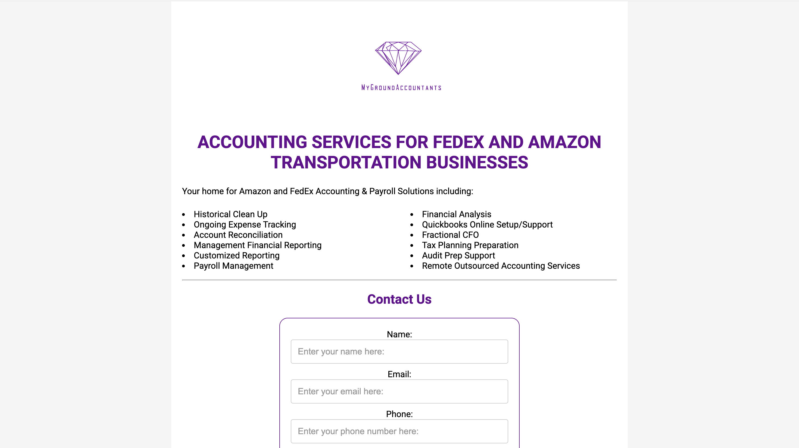
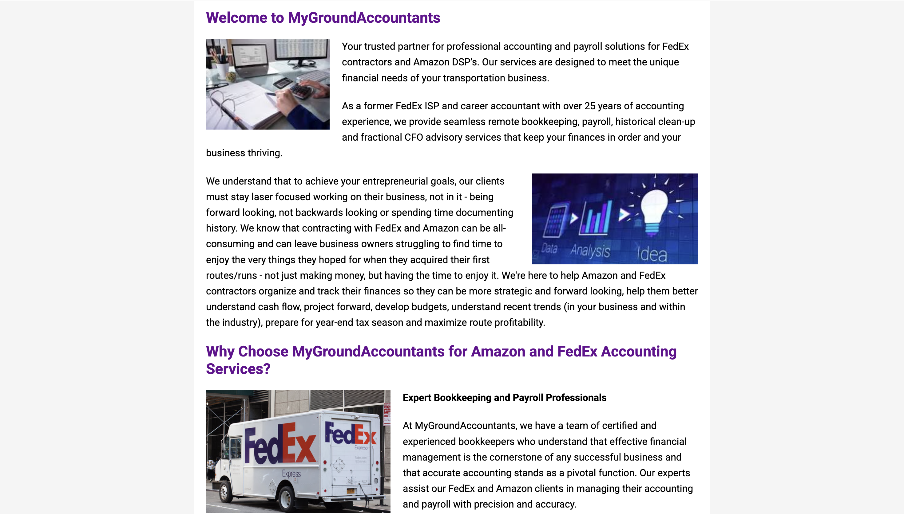
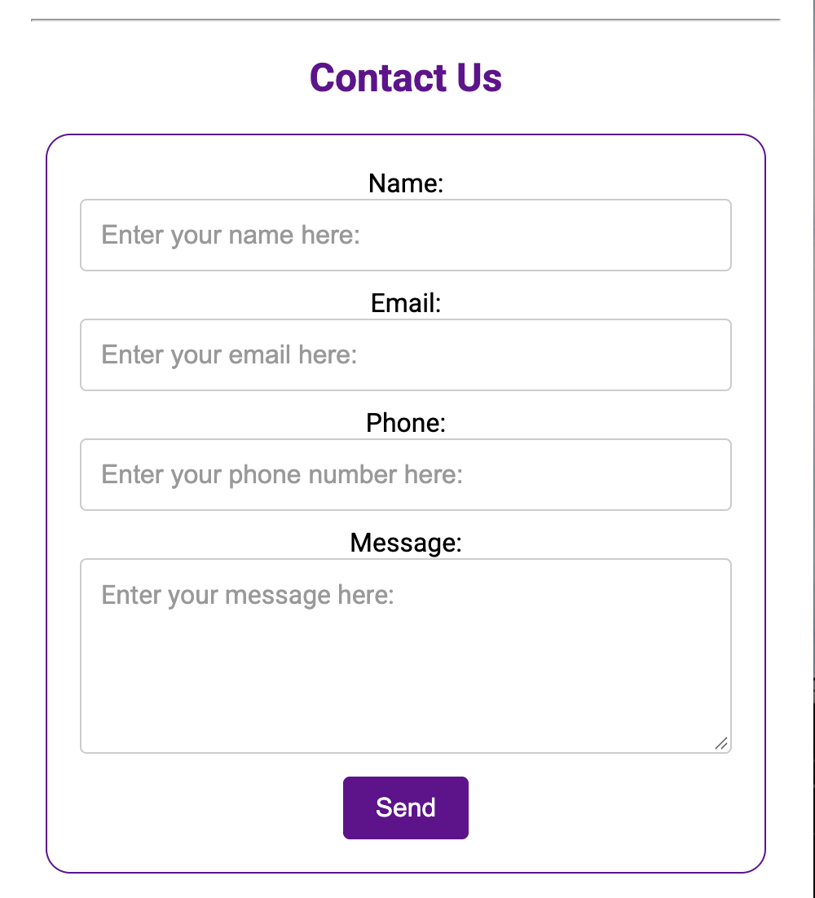

 

<header>
    
</header>

 

## Client

MyGroundAccountants

 

## Services Provided

Web Design, Web Development (Programming)

 

## Project Description

MyGroundAccountants is an accounting business that serves other FedEx and Amazon transportation businesses. The remote business needed a dedicated online presence to communicate its specialized services to prospective clients.

I developed a business landing page, incorporating the client's existing logo and color scheme to maintain brand consistency.

Beyond website development, I implemented a contact form to allow prospective clients to submit inquiries, integrated Google Analytics, and established the business's Google Business Profile so that clients could find them online.

 

# Business Problem

Without a dedicated website, MyGroundAccountants lacked a centralized online destination where prospective clients could learn about its accounting services and contact the business.

The project presented an opportunity to establish a professional digital presence that clearly communicated the business's services while providing a direct way for potential clients to initiate contact.

 

# My Solution

I developed a landing page designed to introduce the accounting service and encourage prospective clients to submit inquiries.

My responsibilities included:

**Website Development**
* **Landing page:** Built a business landing page
* **Brand consistency:** Incorporated the client's existing logo and color scheme into the website design
* **Lead generation:** Implemented a contact form to allow visitors to submit inquiries directly through the website
* **Website analytics:** Integrated Google Analytics to measure website activity.

**Google Business Profile**

I created the business's Google Business Profile to establish its presence in Google Search and Maps.

My responsibilities included setting up the profile and entering the business information, with the company biography provided by the client.

 

# The Result

The project delivered a dedicated business landing page and established the business's online presence.

The client averaged 17 legitimate form submissions per year over the first two years of the website, earning the client thousands in revenue per year.